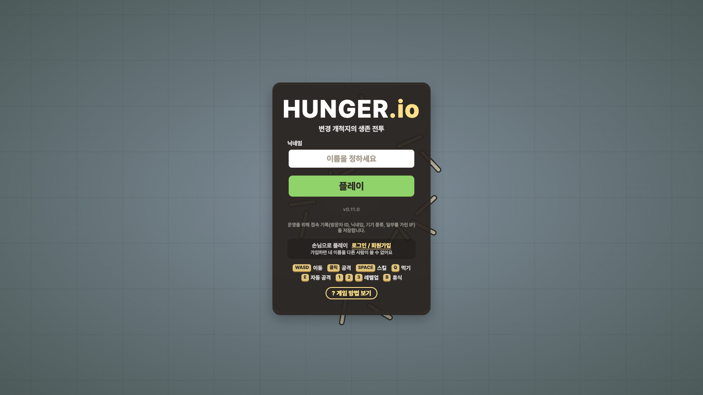
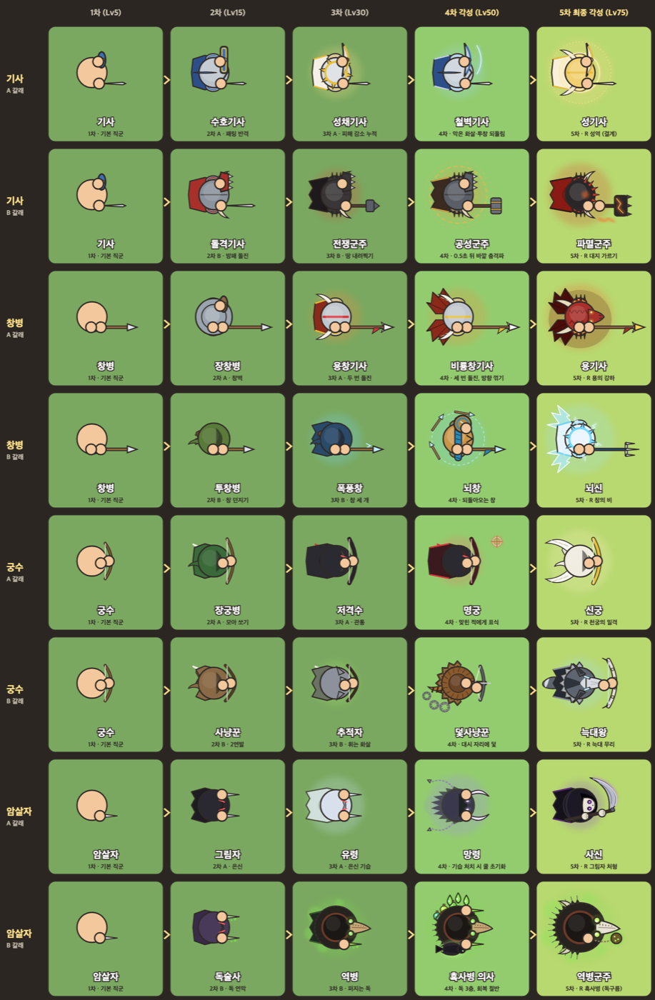
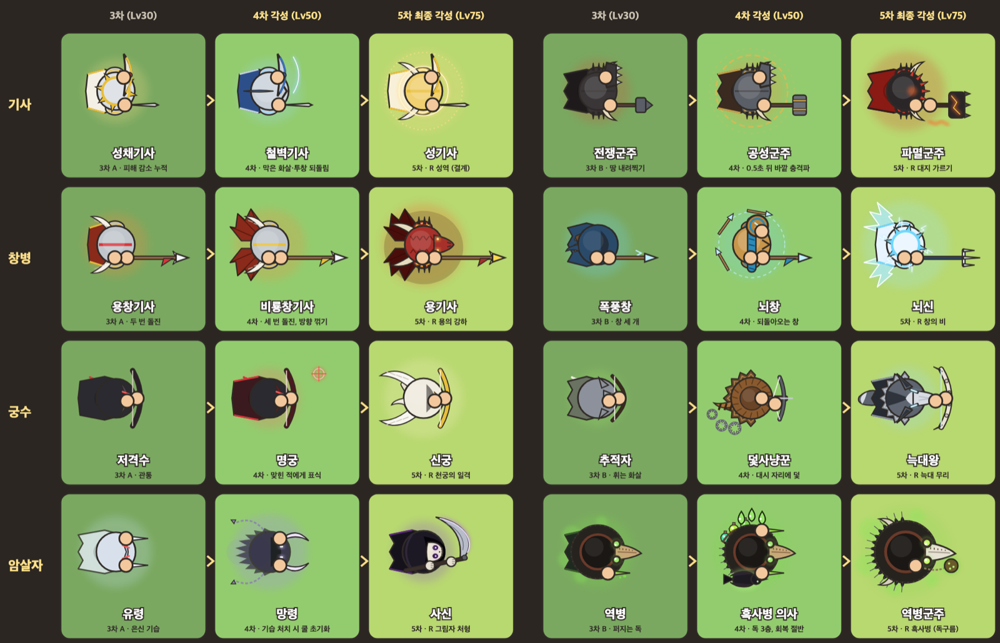

# HUNGER.io

**변경 개척지의 생존 전투**

브라우저에서 바로 하는 실시간 대전 io 게임. 설치도 가입도 필요 없어요.

### [▶ 지금 플레이하기 — hungerio.io](https://hungerio.io)

---

## 어떤 게임인가요?

드넓은 변경 개척지에서 나무와 돌을 캐고, 동물을 사냥하고, 다른 개척자와 싸우며 강해지는 게임입니다.
레벨 1 견습생으로 시작해 **다섯 번의 전직**을 거쳐 최종 각성까지 올라가 보세요. 쓰러지면 처음부터 다시 시작이니, 언제 싸우고 언제 물러날지가 실력입니다.

- **브라우저에서 바로**: PC 브라우저로 접속하면 끝. 손님으로 바로 하거나, 가입하면 내 이름을 다른 사람이 못 써요
- **모두와 싸울 수 있어요**: 레벨과 관계없이 누구와도 겨룰 수 있고, 나보다 강한 상대를 쓰러뜨리면 그 사람이 모은 경험치의 일부를 현상금으로 받아요
- **넓은 세계**: 시작 평원부터 네 모서리의 설원·늪·협곡·안개 숲, 가운데의 화산까지. 깊이 들어갈수록 강한 동물이 나오고 보상도 커져요
- **함께 잡는 보스**: 지역마다 둥지를 지키는 보스가 있어요. 혼자서는 어렵고, 같은 레벨 셋 정도가 힘을 모아야 쓰러뜨릴 수 있어요

## 직군: 4갈래 · 5단계 · 36직군

레벨 5에 기사·창병·궁수·암살자 중 하나를 고르고, 레벨 15·30에 갈래를 정하고, 레벨 50·75에 각성합니다.
최종 각성(5차)부터는 **R 키 궁극기**가 생겨요.

| 기본 (Lv5) | 2차 (Lv15) | 3차 (Lv30) | 4차 각성 (Lv50) | 5차 최종 각성 (Lv75) |
|---|---|---|---|---|
| **기사** | 수호기사 | 성채기사 | 철벽기사 | 성기사 · 성역 |
| | 돌격기사 | 전쟁군주 | 공성군주 | 파멸군주 · 대지 가르기 |
| **창병** | 장창병 | 용창기사 | 비룡창기사 | 용기사 · 용의 강하 |
| | 투창병 | 폭풍창 | 뇌창 | 뇌신 · 창의 비 |
| **궁수** | 장궁병 | 저격수 | 명궁 | 신궁 · 천궁의 일격 |
| | 사냥꾼 | 추적자 | 덫사냥꾼 | 늑대왕 · 늑대 무리 |
| **암살자** | 그림자 | 유령 | 망령 | 사신 · 그림자 처형 |
| | 독술사 | 역병 | 흑사병 의사 | 역병군주 · 흑사병 |

3차 → 4차 → 5차 각성 모습 크게 보기

## 조작

| 키 | 하는 일 |
|---|---|
| `WASD` / 방향키 | 이동 |
| 마우스 클릭 (누르고 있으면 연속) | 공격, 채집 |
| `SPACE` | 직군 스킬 (이중·삼중 돌진은 다시 눌러 한 번 더, 뇌창은 다시 눌러 창 회수) |
| `R` | 궁극기 (5차 최종 각성부터) |
| `Q` | 식량 먹기 (체력 회복) |
| `E` | 자동 공격 켜고 끄기 |
| `1` `2` `3` | 레벨업 능력치 고르기 · 전직 고르기 |
| `B` | 휴식 (3.5초 동안 가만히 있으면 안전하게 쉬기) |
| `ESC` | 메뉴 |

## 이렇게 하면 쉬워요

- 처음엔 **시작 평원**에서 나무·돌을 캐고 토끼·사슴을 잡으며 레벨 5까지
- 체력이 줄면 **Q로 식량을 먹어** 회복. 어려운 구역일수록 덤불과 동물이 식량을 더 줘요
- 내 레벨에 맞는 구역은 화면 위에 **권장 레벨**로 나와요
- 위험하면 **B로 휴식**. 쉬는 동안은 다른 사람에게 보이지 않아요

## 패치 노트

가장 최근: **v0.11.0** — 이제 모든 레벨끼리 싸울 수 있어요, 맵 끝 표현, 궁수 화살이 끊겨 날아가던 문제 수정

👉 [전체 패치 노트 보기](PATCH_NOTES.md)

---

**[hungerio.io](https://hungerio.io)** 에서 만나요!

