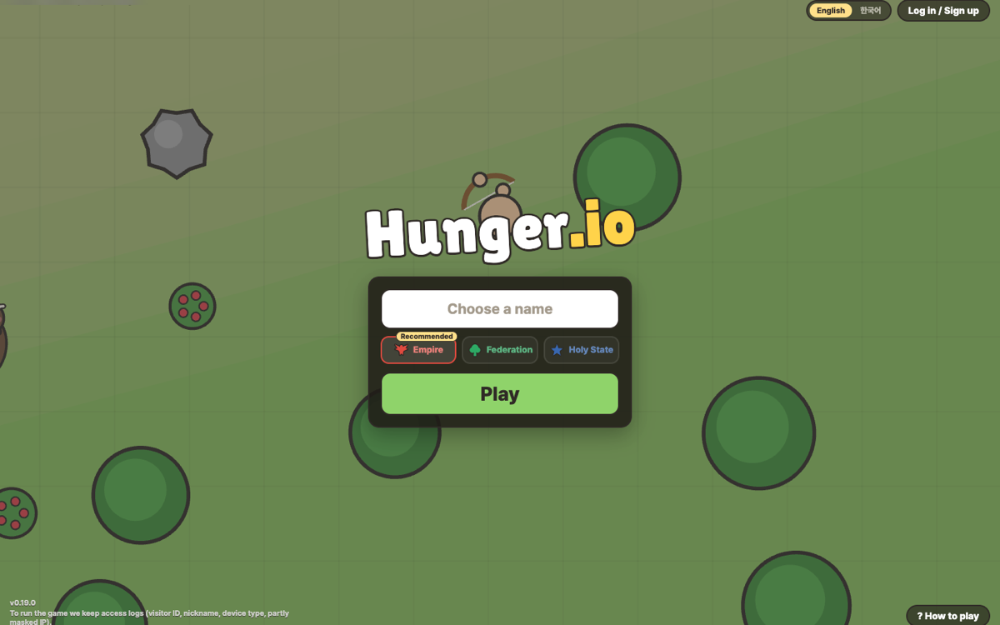

  

  <b>A medieval frontier PvP .io game you play right in your browser.</b> 
  <a href="https://hungerio.io"><b>▶ Play at hungerio.io</b></a>

  

## How to play

- **Gather and hunt.** Chop trees, mine rocks and hunt animals to level up.
- **Grow stronger.** Pick a stat every level, choose a class at level 5 and keep promoting as you climb.
- **Pick a nation.** Join the Empire, the Federation or the Holy State. Members of the same nation can't hurt each other.
- **Fight anyone.** Defeat stronger players for more XP. If you fall, you start again from level 1.

## Classes

| Class | Style |
|---|---|
| Knight | Tough and close-range. Parries attacks |
| Spearman | Long reach. Charges forward with a thrust |
| Archer | Shoots from afar. Dashes backward |
| Assassin | Fast and fragile. Rolls past danger |

## Controls

| Key | Action |
|---|---|
| `WASD` | Move |
| Mouse | Aim |
| Click | Attack · gather |
| `E` | Auto attack |
| `Space` | Skill |
| `Q` | Eat |
| `1` `2` `3` | Pick a level-up |
| `B` | Rest |
| `Esc` | Menu |

## Patch notes

[PATCH_NOTES.md](PATCH_NOTES.md) (Korean)
